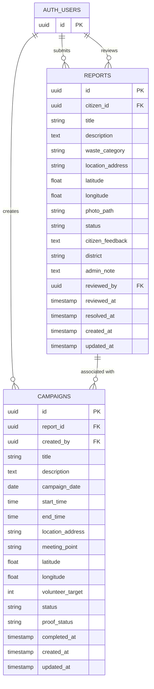

# NagarBondhu (নগর বন্ধু) — Your City, Your Responsibility 🌱

NagarBondhu is a community-driven civic platform that connects citizens, administrators, and volunteers to tackle waste management problems across Bangladesh.

Citizens can report waste issues, administrators can verify reports and organize cleanup campaigns, and volunteers can participate in making their communities cleaner.

---

## Table of Contents

- [Features](#features)
- [User Roles](#user-roles)
- [Database Architecture](#database-architecture)
- [Database Tables](#database-tables)
- [Backend and Security](#backend-and-security)
- [Technology Stack](#technology-stack)
- [Project Structure](#project-structure)
- [Getting Started](#getting-started)
- [Future Improvements](#future-improvements)

---

## Features

- **Waste Reporting:** Citizens can submit waste reports with descriptions, categories, locations, coordinates, and photographs.
- **Report Verification:** Administrators can review reports, update statuses, and add administrative notes.
- **Cleanup Campaigns:** Administrators can create and manage campaigns associated with waste reports.
- **Volunteer Participation:** Volunteers can access campaign information and participate in cleanup activities.
- **Personal Dashboard:** Citizens can track their submitted reports.
- **Bangladesh Campaign Map:** Interactive map displaying cleanup campaign activity by division and district.
- **Multilingual Support:** English and Bangla language options.
- **Responsive Interface:** Supports desktop and mobile devices.

## User Roles

NagarBondhu supports three user roles:

| Role | Responsibilities |
|---|---|
| Citizen | Submit waste reports and track their progress. |
| Administrator | Verify reports, manage campaigns, and oversee platform activities. |
| Worker / Volunteer | Access campaign information and participate in cleanup activities. |

---

## Database Architecture

NagarBondhu uses **Supabase PostgreSQL** as its primary database.

### Entity Relationship Diagram (ERD)

The following diagram illustrates the relationships between the main database entities.



### Database Relationships

| Relationship | Description |
|---|---|
| Users → Reports | A citizen can submit multiple reports. |
| Users → Reviewed Reports | An administrator can review multiple reports. |
| Users → Campaigns | An administrator can create multiple campaigns. |
| Reports → Campaigns | Campaigns reference their associated waste reports through `report_id`. |

*The ERD assumes a report can have multiple associated campaigns. Confirm the actual foreign-key constraints and uniqueness rules in your database.*

### Database View: `campaign_map_data`

NagarBondhu uses a dedicated PostgreSQL view to retrieve information for the public Bangladesh campaign map.

The view combines campaign information with its associated report.

It provides:

- Campaign ID
- Campaign title
- Campaign date
- Campaign status
- District

The frontend uses this data to group campaigns by district and division and display campaign statistics on the interactive map.

---

## Database Tables

### 1. Reports

Stores waste problems submitted by citizens.

| Column | Description |
|---|---|
| `id` | Unique report identifier (PK) |
| `citizen_id` | Report creator (FK) |
| `title` | Report title |
| `description` | Problem details |
| `waste_category` | Waste category |
| `location_address` | Problem location |
| `latitude` | Geographic latitude |
| `longitude` | Geographic longitude |
| `photo_path` | Report photograph reference |
| `status` | Current report status |
| `citizen_feedback` | Citizen feedback |
| `district` | Associated district |
| `admin_note` | Administrator's note |
| `reviewed_by` | Reviewing administrator (FK) |
| `reviewed_at` | Review timestamp |
| `resolved_at` | Resolution timestamp |
| `created_at` | Creation timestamp |
| `updated_at` | Last update timestamp |

### 2. Campaigns

Stores cleanup campaign information.

| Column | Description |
|---|---|
| `id` | Unique campaign identifier (PK) |
| `report_id` | Associated report (FK) |
| `created_by` | Campaign creator (FK) |
| `title` | Campaign title |
| `description` | Campaign details |
| `campaign_date` | Scheduled date |
| `start_time` | Starting time |
| `end_time` | Ending time |
| `location_address` | Campaign location |
| `meeting_point` | Volunteer meeting point |
| `latitude` | Geographic latitude |
| `longitude` | Geographic longitude |
| `volunteer_target` | Target number of volunteers |
| `status` | Campaign status |
| `proof_status` | Completion proof status |
| `completed_at` | Completion timestamp |
| `created_at` | Creation timestamp |
| `updated_at` | Last update timestamp |

### 3. Authentication: `auth.users`

Supabase Auth manages user identities and authentication.

The application uses the authenticated user's UUID to associate users with reports and campaigns.

---

## Backend and Security

**Supabase** provides the backend infrastructure.

- **Supabase Auth:** User authentication and identity management.
- **PostgreSQL:** Stores reports, campaigns, and related information.
- **Row Level Security (RLS):** Controls database access based on user permissions.
- **Database Views:** Provides controlled data access for public campaign visualization.
- **Supabase JavaScript Client:** Connects the React application to the backend.

Database security policies control operations such as:

- Citizens creating and viewing their own reports.
- Administrators reviewing and managing reports.
- Administrators creating and managing campaigns.
- Controlling public access to campaign map information.

Frontend route protection and role-based navigation provide additional application-level access control.

---

## Technology Stack

| Category | Technology |
|---|---|
| Frontend Framework | React 18 |
| Build Tool | Vite |
| Language | JavaScript / JSX |
| Styling | Tailwind CSS |
| Backend Platform | Supabase |
| Database | PostgreSQL |
| Authentication | Supabase Auth |
| Database Security | PostgreSQL RLS |
| Database Integration | Supabase JavaScript Client |
| Routing | React Router DOM |
| Internationalization | i18next, react-i18next |
| Animations | Framer Motion |
| Icons | Lucide React |

---

## Project Structure

The project follows a component-based React architecture.

```text
NagarBondhu/
│
├── public/
│
├── src/
│   ├── components/
│   │   ├── common/
│   │   ├── data/
│   │   ├── landing/
│   │   ├── layout/
│   │   └── ...
│   │
│   ├── context/
│   │   └── AuthContext.jsx
│   │
│   ├── hooks/
│   │   └── Usecampaignstats.js
│   │
│   ├── lib/
│   │   └── supabaseClient.js
│   │
│   ├── pages/
│   │
│   ├── utils/
│   │
│   ├── App.jsx
│   └── main.jsx
│
├── .env.example
├── package.json
└── README.md
```

*This is an illustrative structure. Actual filenames and folders may differ.*

---

## Getting Started

### Prerequisites

- Node.js
- npm
- Git
- Supabase account and project

### 1. Clone the Repository

```bash
git clone YOUR_REPOSITORY_URL
cd NagarBondhu
```

### 2. Install Dependencies

```bash
npm install
```

### 3. Configure Environment Variables

Create a `.env` file in the project root.

```env
VITE_SUPABASE_URL=YOUR_SUPABASE_PROJECT_URL
VITE_SUPABASE_ANON_KEY=YOUR_SUPABASE_ANON_KEY
```

Get these values from your Supabase project settings.

**Security:** Never commit your `.env` file or expose your Supabase service-role key in frontend code.

### 4. Start Development Server

```bash
npm run dev
```

### 5. Build for Production

```bash
npm run build
```

### 6. Preview Production Build

```bash
npm run preview
```

---

## Future Improvements

- Real-time report status notifications.
- Volunteer registration and attendance tracking.
- Campaign completion evidence and verification.
- Advanced campaign analytics.
- Location-based campaign discovery.
- Improved administrative reporting tools.

---

## Project Vision

**A cleaner city starts with responsible citizens and organized community action.**

NagarBondhu aims to turn individual waste reports into meaningful community cleanup activities.

**NagarBondhu — Your City. Your Responsibility.**

---

## License

No open-source license has been specified yet. A `LICENSE` file should be added before distributing the project under an open-source license.